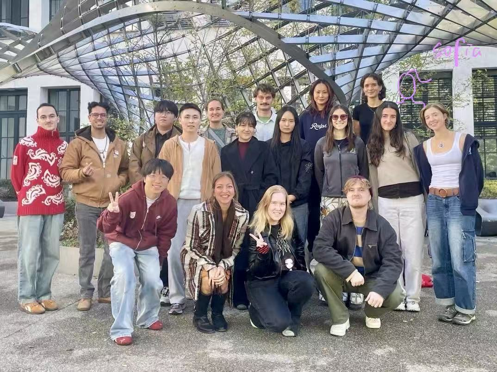

  

<h1 align="center">Birthday Atlas</h1>

Cartography · 16th Intake

<a href="https://rzt1an.github.io/Birthday-Atlas---16th-intake/"><strong>Open the atlas ↗</strong></a>

We make maps. We also make time for cake.

Pick a birthday to find a familiar face in the group photo and see where they call home. Head to **Events** for the stories we’ve collected along the way, from sparklers to some very creative candle maths.

Want a reminder before the next slice? Use **Add birthdays to my calendar** on the site. Birthdays repeat every year.

Adding to the atlas

Add new celebration photos to `events/<name>/` and link them from the Events section in `index.html`. Edits made in the website editor are saved in that browser. If you change a birthday, update both `index.html` and `cartography-16th-birthdays.ics`.

