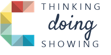

<h1>
 
Birthday Atlas
</h1>

> ### *We make maps. We also make time for cake.*

We are a group of students from the 16th intake of Cartography M.Sc. This is where we keep track of each other's birthdays and collect photos from the ones we've celebrated together. [View Birthday Atlas](https://rzt1an.github.io/Birthday_Atlas_16Intake/)

### Around the atlas

Pick a birthday to find a familiar face in the group photo and see where they call home. Head to **Events** for the stories we’ve collected along the way, from sparklers to some very creative candle maths.

### Birthday reminders

Want a reminder before the next slice? Use **Add birthdays to my calendar** on the site. Birthdays repeat every year.

> **P.S.** Open the atlas on your birthday. There’s a little surprise waiting for you!

### Adding to the atlas

At the bottom of the website’s Events section, choose **Edit events with a class invitation**. Use the class invitation to edit a celebration’s story, add photos, or remove photos from its gallery.

This little atlas is ours. After entering the class password, pick how you’d like to chip in.

- **Sign in with GitHub** to have your saved edits credited to your GitHub account as a contributor.
- **Continue as a guest** if you’d rather keep your name off the edits. Our class bot will do the GitHub paperwork for you.

> [!NOTE]
> **Hint:** Look at the room number on the door of our usual classroom. :)
>
